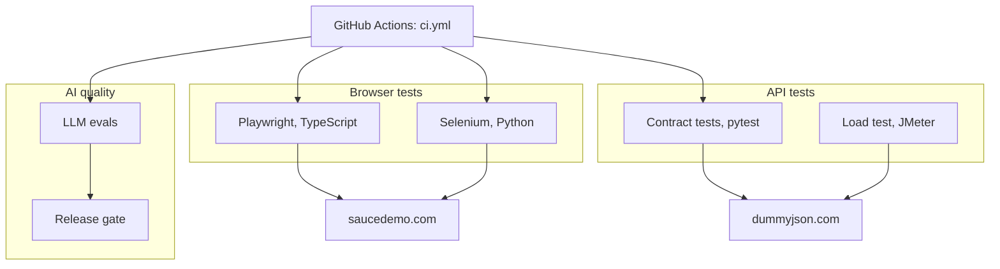

# QA automation portfolio

[](https://github.com/EarlFernandes/qa-automation-portfolio/actions/workflows/ci.yml)
[](https://github.com/EarlFernandes/qa-automation-portfolio/actions/workflows/jmeter.yml)
[](https://github.com/EarlFernandes/qa-automation-portfolio/actions/workflows/llm-evals-live.yml)
[](https://github.com/EarlFernandes/qa-automation-portfolio/actions/workflows/docker.yml)
[](https://earlfernandes.github.io/qa-automation-portfolio/)


Sample test code by **Earl Fernandes**, Senior QA Engineer and SDET. Every suite in this repository runs against a public demo site or a public API, so anyone can clone it and run it. The code shows the patterns I use at work: page objects with fixtures, a strict locator strategy, contract tests from JSON Schema files, a parameterized load test, and a release gate for an LLM feature that scores a model against a golden dataset in CI.

Nothing here comes from an employer. All data, targets and names are public or synthetic.

Latest reports, rebuilt after every green run on main: [earlfernandes.github.io/qa-automation-portfolio](https://earlfernandes.github.io/qa-automation-portfolio/) (Playwright HTML report, self-healing report, LLM eval report).

## Start here

If you have five minutes, read these in order:

1. [`playwright/src/fixtures/test.ts`](playwright/src/fixtures/test.ts) and [`playwright/tests/checkout.spec.ts`](playwright/tests/checkout.spec.ts). Page objects arrive through fixtures, tests read like a user story, and the totals math is asserted in cents.
2. [`llm-evals/src/llm_evals/scoring.py`](llm-evals/src/llm_evals/scoring.py) and [`llm-evals/gate.yaml`](llm-evals/gate.yaml). How an LLM output is scored field by field, and how a metric earns the right to block a release.
3. [`playwright/src/healing/heal.ts`](playwright/src/healing/heal.ts) and [`playwright/tests/healing.spec.ts`](playwright/tests/healing.spec.ts). Self-healing locators done the safe way: a stale locator falls through to a fallback, the test continues, and the heal is logged as a proposal for review. No code is rewritten by a machine.
4. [`.github/workflows/ci.yml`](.github/workflows/ci.yml) and [`.github/workflows/llm-evals-live.yml`](.github/workflows/llm-evals-live.yml). All suites run on every push. The offline eval gate runs on every pull request; the live run scores a real model on a schedule with its own gate.

## What is inside

| Folder | Stack | What it shows | Size |
| --- | --- | --- | --- |
| [`playwright/`](playwright/) | TypeScript, Playwright 1.63, axe-core, ESLint | Page objects plus fixtures, `data-test` locators, sign-in once with `storageState`, aria snapshots, tags, network control, desktop and mobile projects, self-healing locators, accessibility scans with a baseline ratchet, on-demand visual regression, Dockerfile | 84 tests + 3 visual |
| [`selenium/`](selenium/) | Python, Selenium 4, pytest | Classic page object model with explicit waits, Selenium Manager, screenshots on failure, data-driven login | 13 tests |
| [`api-tests/`](api-tests/) | Python, pytest, httpx, JSON Schema | Contract tests for a REST API and a GraphQL API, auth token flow, pagination math, negative cases, response time checks | 19 tests |
| [`jmeter/`](jmeter/) | Apache JMeter 5.6 | Parameterized load plan with CSV data, JSON extraction, assertions and a non GUI run script that builds the HTML dashboard | 4 samplers |
| [`llm-evals/`](llm-evals/) | Python, pydantic 2, Anthropic and OpenAI SDKs | Golden dataset, field accuracy with numeric tolerance, completeness, schema conformance, line item matching, heuristic judge, HTML and JUnit reports, CI release gate with a promotion policy, offline regex extractor plus live model adapters with retries and token accounting | 14 cases, 47 unit tests |

Targets: [saucedemo.com](https://www.saucedemo.com) for the browser suites, [dummyjson.com](https://dummyjson.com) and [countries.trevorblades.com](https://countries.trevorblades.com) for the API and load tests. The eval harness runs offline with a rule-based extractor on every pull request, and against a real model (Anthropic or OpenAI) on a weekly schedule.

Documents: [test strategy](docs/test-strategy.md), [sample bug reports](docs/sample-bug-reports.md), [architecture notes and diagrams](docs/architecture.md).

## How the parts fit together



More diagrams, including the Playwright fixture graph and the eval pipeline, are in [`docs/architecture.md`](docs/architecture.md).

## Quick start

Each folder has a README with the full commands. The short version:

```bash
# Playwright (Node 22)
cd playwright && npm ci && npx playwright install --with-deps chromium && npx playwright test
npm run test:visual      # screenshot comparison against the committed Linux baselines

# Selenium (Python 3.11+, Chrome installed)
cd selenium && pip install -r requirements.txt && python -m pytest

# API contract tests
cd api-tests && pip install -r requirements.txt && python -m pytest

# LLM evals: unit tests, eval run, release gate
cd llm-evals && pip install -e ".[dev]" && python -m pytest
llm-evals run --dataset data/golden.jsonl --extractor regex --out reports/
llm-evals gate --results reports/results.json --config gate.yaml --history reports/gate_history.json
# Same harness against a real model (needs ANTHROPIC_API_KEY or OPENAI_API_KEY)
llm-evals run --dataset data/golden.jsonl --extractor anthropic --out reports/
llm-evals gate --results reports/results.json --config gate.live.yaml --history reports/gate_history.live.json

# JMeter (Java 17 and Apache JMeter 5.6)
cd jmeter && ./run.sh
```

A `Makefile` at the root wraps the same commands: `make playwright`, `make selenium`, `make api`, `make evals`, `make jmeter`.

## Beyond the basics

- **Self-healing locators, heal-and-propose.** A stale locator falls through an ordered list of candidates, the test continues, and the heal is logged as a proposal in the HTML report and the CI job summary. No code is ever rewritten by a machine, and the unhealed run stays the gate. An optional LLM proposer is included as a reference and is off by default.
- **Accessibility scans with axe-core** on three pages. Any critical finding fails the run. Every other finding must be in a checked-in baseline, and a fixed finding must leave the baseline, so new issues cannot slip in.
- **Visual regression** with Playwright screenshots and a 2 percent pixel budget, run on demand because baselines are platform specific. Linux baselines are committed.
- **Live LLM evals in CI.** The same harness scores a real model on a weekly schedule from a repository secret, with its own gate (`gate.live.yaml`) where new metrics start as candidates and earn blocking status after two clean runs. Token usage is recorded per case.
- **Published reports.** After every green run on main, the Playwright report, the healing report and the LLM eval report are published to GitHub Pages.
- **Docker.** The Playwright suite has a Dockerfile on the official image for the pinned version; a workflow builds it and runs the smoke tests inside the container.
- **Flaky test policy.** Retries with traces in CI, a `@quarantine` tag with an issue link, a fix-within-the-sprint rule, and CI runs with quarantined tests excluded.

## Principles I follow

**Locators.** Prefer what the user sees: `getByRole`, `getByLabel`, `getByPlaceholder`, `getByText`. Then a dedicated test attribute (`data-test` here). Never XPath, never CSS tied to styling classes. The Selenium suite follows the same order with locator tuples.

**Page objects plus fixtures.** Page objects hold locators and actions. Fixtures build them and hand them to tests, so tests have no setup noise. Sign-in happens once in a setup project and every test starts signed in through `storageState`.

**No sleeps.** Every wait is for a condition: a URL, a visible element, a text value. Flaky tests are fixed at the cause and the fix is explained in a comment.

**Contracts as files.** API shapes live in JSON Schema files next to the tests, so a schema change is a reviewable diff.

**Evals are tests.** An LLM feature gets a golden dataset, metrics with thresholds, and a gate in CI. A new metric starts as a candidate and becomes blocking only after it passes in two consecutive runs. The answer key is never edited to make a run pass.

**Small load, real signal.** The load plan runs against a public API, so the default profile is tiny. The point is the plan design: parameters from properties, data from CSV, token extraction, assertions, and a dashboard you can read.

## CI

[`ci.yml`](.github/workflows/ci.yml) runs four jobs in parallel on every push and pull request: Playwright (with the a11y project and the healing summary), Selenium, API tests, and the offline LLM eval run followed by the gate. Each job uploads its report as an artifact. The gate history is cached between runs so the promotion policy works in CI too.

[`llm-evals-live.yml`](.github/workflows/llm-evals-live.yml) scores a real model every Monday and on demand, using the `ANTHROPIC_API_KEY` or `OPENAI_API_KEY` repository secret, and gates with `gate.live.yaml`. [`pages.yml`](.github/workflows/pages.yml) publishes the reports to GitHub Pages after each green CI run. [`docker.yml`](.github/workflows/docker.yml) builds the Playwright image and runs the smoke tests inside it. [`jmeter.yml`](.github/workflows/jmeter.yml) runs by hand with the user count and loop count as inputs.

## About me

Senior QA Engineer and SDET with 8+ years in test automation, API testing, performance testing and release quality, now focused on quality for AI and LLM products. Open to remote roles.

- LinkedIn: [linkedin.com/in/earl-fernandes-qa](https://www.linkedin.com/in/earl-fernandes-qa/)
- Email: earlspen2001@gmail.com

## License

MIT. See [`LICENSE`](LICENSE).
