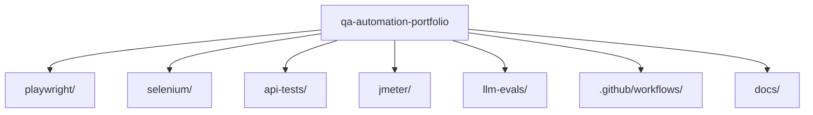
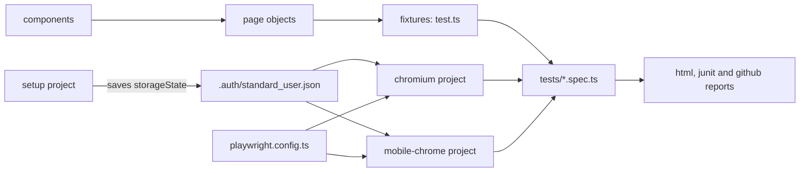
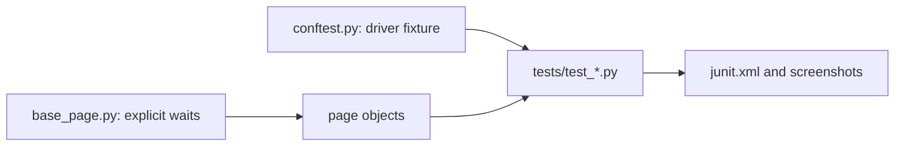
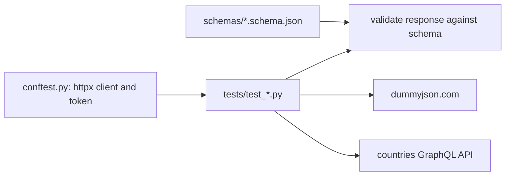
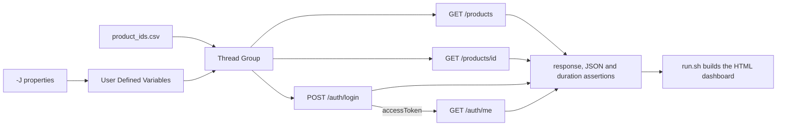
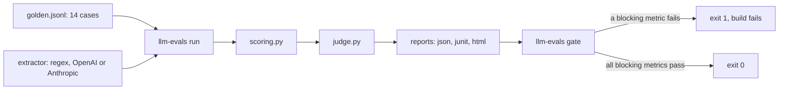
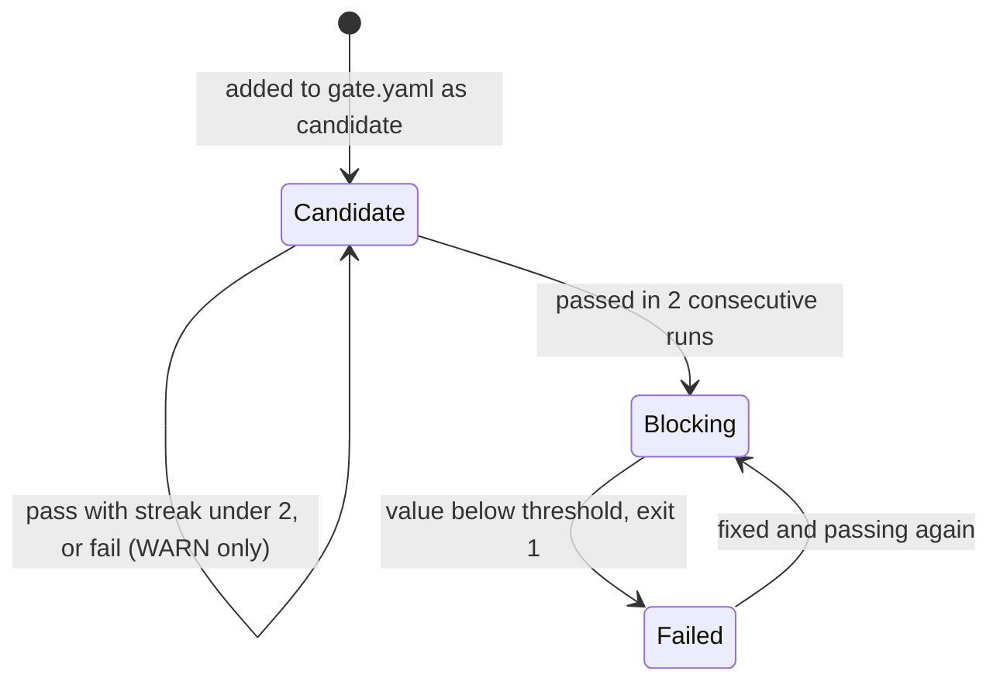
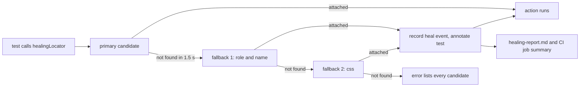
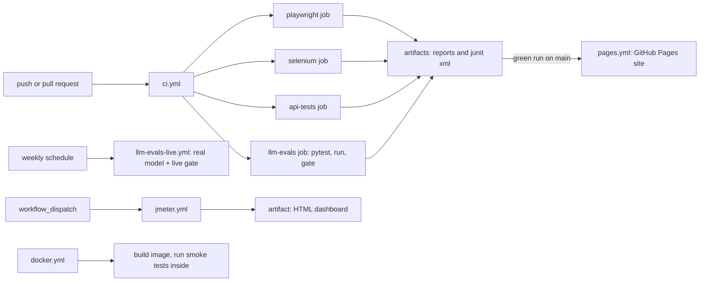

# Architecture notes

This page explains how each suite is built and why. The diagrams render on GitHub.

## Repository map

## Playwright suite

The suite signs in once, saves the browser state, and reuses it in every test. Page objects reach the tests through fixtures.

Design choices:

- Locator order: role, label, placeholder, text, then `data-test`. No XPath. No styling classes.
- Product cards are component objects built with `locator.filter({ hasText })`, so a test says "add Sauce Labs Backpack" and never counts rows.
- Every wait is a condition. `waitForURL` after navigation, web-first assertions for state.
- Money is handled in cents. The checkout test asserts item total, 8% tax and grand total from the prices it reads on the page.
- Tags select subsets: `npx playwright test --grep @smoke`.

## Selenium suite

Same site, same page object idea, written the classic way for teams that run Selenium.

Selenium Manager downloads the matching driver, so there is no driver to install. Explicit waits replace implicit waits and sleeps.

## API contract tests

Each endpoint has a shape test, a behavior test (pagination math, totals, search), and a negative test (unknown id, wrong password). Response time is asserted with a generous bound so the test fails on an outage, not on jitter.

## JMeter load plan

## LLM evals and the release gate

The harness treats a model like any other system under test. The dataset is the specification, the scorer is the oracle, and the gate is the pass or fail decision.

How a metric earns the right to block:

Rules that keep the signal honest:

- The answer key is never edited to make a run pass. A key entry changes only when the key itself is wrong, and the reason is recorded in `data/README.md`.
- Numbers compare with a 2% relative tolerance or 0.01 absolute, whichever is larger. Strings compare after normalization. Line items match by a fingerprint of description and quantity, then by position.
- Warn-only metrics show up in the report but never fail the build. That keeps new ideas visible without blocking releases.

## Self-healing locators

`playwright/src/healing/heal.ts` resolves an ordered list of locator candidates. The first candidate is the one the test author wrote. When it is not attached within a short timeout, the next candidate is tried. A fallback that wins is recorded as a healing event with the test title, the page URL, the primary locator, the winner and a proposed code change. The global teardown writes `results/healing-report.md` and appends it to the GitHub job summary.

The policy is heal-and-propose. The unhealed run stays the gate in CI. A person reviews each proposal and decides whether the locator was stale or the product regressed.

## Live LLM evals

`llm-evals-live.yml` runs the same harness with the Anthropic or OpenAI adapter. Prompts embed the JSON schema and ask for JSON only. Calls retry with backoff on rate limits and connection errors, never on auth errors. Token usage is recorded per case. The live gate (`gate.live.yaml`) keeps schema conformance, extraction rate and latency blocking from the first run, and starts accuracy and completeness as candidates that earn blocking status after two consecutive passes.

## Published reports

`pages.yml` waits for a green CI run on main, downloads its artifacts, assembles a small site with `scripts/build_pages_site.sh`, and deploys it to GitHub Pages: the Playwright HTML report, the healing report and the LLM eval report.

## CI

