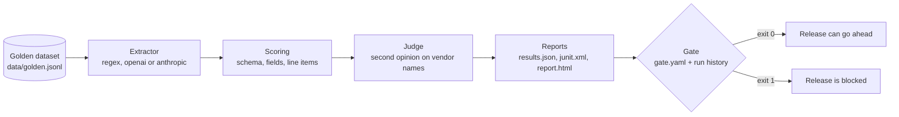

# LLM evals: a release gate for structured extraction

This harness answers one question for a team that ships an LLM feature: can this version go out?

The example task is invoice extraction. The input is the plain text of an invoice email. The output must be JSON that matches a strict schema. The harness runs an extractor over a golden dataset, scores every field, writes a report, and then a gate command decides pass or fail from the dataset level metrics. The gate is meant to run in CI on every change to a prompt, a model or the extraction code.

Everything runs offline by default. No API key and no network are needed.

## What a recruiter should look at first

1. `src/llm_evals/scoring.py`: the scoring rules, including numeric tolerance and line item matching.
2. `src/llm_evals/gate.py` and `gate.yaml`: the release gate and the promotion policy.
3. `tests/test_end_to_end.py`: the whole pipeline on the golden set, with the expected baseline pinned.

## How it works



One run does this for every case:

1. Read the case: the email text and the answer key.
2. Call the extractor and measure its latency.
3. Validate the output against the `Invoice` schema (pydantic, extra fields forbidden).
4. Compare every scalar field with the key.
5. Match line items by fingerprint (normalized description plus quantity). Items with no fingerprint partner fall back to positional order. Missing and extra items are failures.
6. Ask the judge about the vendor field when the exact comparison failed.
7. Write the per case result.

Then the run computes the dataset metrics and writes the three report files. The gate command reads `results.json` and compares the metrics with `gate.yaml`.

## Metrics

| Metric | Meaning |
|---|---|
| `extraction_rate` | Share of cases where the extractor returned an object without an error. |
| `schema_conformance_rate` | Share of cases whose output validates against the schema. |
| `mean_field_accuracy` | Mean over cases of passed checks divided by all checks. |
| `mean_completeness` | Mean over cases of expected non-null fields that came back non-null. |
| `case_pass_rate` | Share of cases with a valid schema and every check passed. |
| `p95_latency_ms` | 95th percentile of extractor latency. |
| `judge_override_rate` | Share of cases where the judge turned a failed vendor check into a pass. |

Comparison rules:

- Strings match after normalization: casefold, punctuation removed, whitespace collapsed.
- Numbers match within 2% relative tolerance or 0.01 absolute, whichever is larger.
- A null in the key must come back as null.

## The gate and the promotion policy

`gate.yaml` lists every metric with a threshold and a mode:

| Mode | Behaviour |
|---|---|
| `blocking` | A failure fails the gate (exit code 1). |
| `warn` | A failure is reported as WARN. The gate still passes. |
| `candidate` | Warn only, until the metric has passed in two consecutive recorded runs. From then on it blocks. |

The candidate mode is the promotion policy. A new rule must prove it is stable before it can stop a release. A rule that fails after promotion drops back to probation, because the streak is broken. This keeps the gate green unless a stable metric regresses, and it keeps new checks visible from day one without blocking anyone.

Run history is stored in `reports/gate_history.json` (last 20 runs). In CI, cache or commit that file so the streak survives between runs.

Two rules for the answer key, written up in `data/README.md`: never edit the key to make a run pass, and never lower a threshold to make the gate pass. Fix the extractor, or open a ticket.

## Run it

```bash
cd llm-evals
pip install -e ".[dev]"

llm-evals run --dataset data/golden.jsonl --extractor regex --out reports/
llm-evals gate --results reports/results.json --config gate.yaml --history reports/gate_history.json
pytest
```

`python -m llm_evals ...` works the same as `llm-evals ...`.

Expected result with the offline extractor: 12 of 14 cases pass, the gate passes, and the two failing cases are `ao-006` (CA$ read as USD) and `pt-007` (discount line dropped). These are documented weaknesses of the regex extractor and they are there on purpose, so the report shows real failures.

The gate prints a table like this:

```
Metric                   Value  Threshold   Mode                    Status
-----------------------  -----  ----------  ----------------------  ------
extraction_rate          1.000  >= 0.900    blocking                PASS
schema_conformance_rate  1.000  >= 0.900    blocking                PASS
mean_field_accuracy      0.991  >= 0.750    blocking                PASS
mean_completeness        1.000  >= 0.800    blocking                PASS
p95_latency_ms           9 ms   <= 5000 ms  blocking                PASS
case_pass_rate           0.857  >= 0.850    candidate (0/2 passes)  PASS
judge_override_rate      0.071  <= 0.200    warn                    PASS

gate: PASS
```

## Plug in a real model

The extractor contract is one method: `extract(text) -> dict`. Two reference adapters are included:

```bash
pip install -e ".[openai]"
export OPENAI_API_KEY=...
llm-evals run --extractor openai

pip install -e ".[anthropic]"
export ANTHROPIC_API_KEY=...
llm-evals run --extractor anthropic
```

Both adapters lock the model output to the `Invoice` JSON schema (OpenAI through `response_format`, Anthropic through a forced tool call). They are reference code: the tests never call them, and they are not part of the offline run. To add another model, write a class with `name` and `extract` and register it in `src/llm_evals/extractors/__init__.py`.

## Read the HTML report

`reports/report.html` is a single file with no external assets.

- The cards at the top are the dataset metrics.
- The table lists every case with status, accuracy, completeness, schema result and failed check count.
- The details section has one block per case. Failed cases are open. Each row is one check with the expected value, the actual value and a note such as `item missing`, `matched by position` or `passed by judge (heuristic)`.
- The raw extractor output sits under each case.

`reports/junit.xml` has one test case per golden case, so a CI dashboard shows the run like a normal test suite.

## Layout

```
llm-evals/
  gate.yaml                 thresholds and modes
  data/golden.jsonl         14 synthetic cases (answer keys)
  data/generate_golden.py   regenerates the dataset from one source of truth
  data/README.md            answer key rules
  src/llm_evals/
    schema.py               Invoice and LineItem models
    dataset.py              JSONL loader, validates every key
    scoring.py              per case scoring and dataset metrics
    judge.py                heuristic judge, reference LLM judge
    gate.py                 thresholds, modes, promotion policy, history
    report.py               results.json, junit.xml, report.html
    cli.py                  run and gate commands
    extractors/             regex baseline, OpenAI and Anthropic adapters
  tests/                    30 tests: scoring rules, gate policy, end to end
```

## Design notes

- The golden dataset is synthetic and generated from one script, so the text and the key cannot drift apart.
- The regex extractor is the offline stand-in for a model. Its two weaknesses are documented in its docstring and pinned by a test, so a change in behaviour shows up as a test failure.
- The judge is only allowed to rescue the vendor field, and every rescue is counted. A judge that agrees too often is visible in the gate table.
- Latency is measured in the harness, not reported by the extractor, so every extractor is measured the same way.
- The harness never writes to the dataset.
