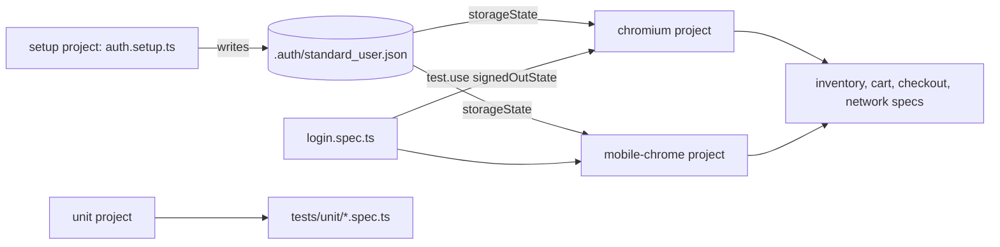

# Playwright end-to-end suite

End-to-end tests for the public Swag Labs demo shop (https://www.saucedemo.com), written in TypeScript with Playwright 1.63.

The suite covers login, the product list, the cart, the full checkout flow, network checks, self-healing locators, and accessibility scans with axe-core. It runs on desktop Chrome and on a Pixel 7 emulation. The default run is 84 tests in about 70 seconds with three workers. Visual regression runs on demand.

## Start here

If you have five minutes, read these three files:

1. `src/fixtures/test.ts`: how tests get their page objects.
2. `src/healing/heal.ts` and `tests/healing.spec.ts`: self-healing locators that propose a fix instead of hiding a change.
3. `tests/checkout.spec.ts`: a full purchase with `test.step` blocks and a check of the order math.

## How to run

```bash
npm install
npx playwright install chromium   # once, downloads the browser
npm test                          # all default projects: unit, setup, chromium, mobile-chrome, a11y
npm run test:ci                   # same, minus tests tagged @quarantine (what CI runs)
npm run test:smoke                # only tests tagged @smoke
npm run test:a11y                 # accessibility scans only
npm run test:visual               # visual regression, on demand (see below)
npm run test:headed               # watch the browser
npm run test:ui                   # Playwright UI mode
npm run report                    # open the last HTML report
npm run typecheck && npm run lint
```

Set `BASE_URL` to point the suite at another deployment of the same app. Set `CI=1` to get retries, two workers and the GitHub reporter.

## Structure

```
playwright/
├── playwright.config.ts        projects, reporters, timeouts, testIdAttribute, healing report hooks
├── playwright.visual.config.ts visual regression config, run on demand
├── a11y.baseline.json          known accessibility findings per page (the ratchet)
├── Dockerfile                  runs the suite in the official Playwright image
├── src/
│   ├── components/             header and product card component objects
│   ├── data/users.ts           the public demo accounts
│   ├── fixtures/test.ts        test fixtures that hand page objects to tests
│   ├── healing/                self-healing locators, report, LLM proposer (off by default)
│   ├── pages/                  one page object per screen
│   └── utils/money.ts          price parsing in cents
└── tests/
    ├── auth.setup.ts           signs in once and saves the browser state
    ├── login.spec.ts           login rules, data-driven accounts, aria snapshot
    ├── inventory.spec.ts       sorting, cart badge, product details, logout
    ├── cart.spec.ts            cart contents, remove, reload
    ├── checkout.spec.ts        full purchase and form validation
    ├── network.spec.ts         route blocking, asset health, API request
    ├── healing.spec.ts         a stale locator heals and is reported
    ├── a11y.spec.ts            axe scans with the critical rule and the baseline ratchet
    ├── visual/                 screenshot checks and their Linux baselines
    └── unit/                   helper tests, no browser
```

## Projects and sign-in



The `setup` project signs in through the real form once and saves cookies and local storage. The browser projects depend on it, so every test starts signed in and the suite pays for one login. `login.spec.ts` overrides `storageState` with an empty state because it tests the login form itself.

The `unit` project runs the money and healing helpers without a browser. The `a11y` project runs the axe scans on desktop Chrome. The `visual` project lives in its own config and is not part of the default run.

## Locator strategy

The site exposes `data-test` attributes, so `testIdAttribute` is set to `data-test` in the config and `getByTestId` works without extra selectors. Locators follow this order:

| Priority | Locator | Example in this suite |
|---|---|---|
| 1 | `getByRole` with an accessible name | `getByRole('button', { name: 'Add to cart' })` |
| 2 | `getByLabel`, `getByPlaceholder` | the checkout form fields |
| 3 | `getByText` with `exact: true` | product names when filtering a card |
| 4 | `getByTestId` | `inventory-item`, `shopping-cart-badge`, `error` |
| 5 | CSS by structure | not used; styling classes change too often |
| never | XPath, nth-child chains | |

Rules the code follows:

- A product is found by name, not by index: `inventoryPage.product('Sauce Labs Backpack')`. The card is `items.filter({ has: getByText(name, { exact: true }) })`.
- Assertions are web-first (`toHaveText`, `toHaveCount`, `toBeVisible`) so they wait and retry. Lists are checked with `toHaveText([...])`, which waits for the whole list to match in order.
- Checks that need computed data use `expect(async () => {...}).toPass()` instead of reading the DOM once.
- No `waitForTimeout`. Navigation waits on the URL or on a visible element of the next page.
- Accessible names are part of the contract: the cart link is asserted with `toHaveAccessibleName('Cart, 1 items')`, and the login form has an aria snapshot.

One real lesson is written down in `src/pages/product-details.page.ts`. The details page reuses the `inventory-item` test id of the product list, and both can be in the DOM for a moment while the app swaps routes. Scoping the details locators to the container that holds the plain `add-to-cart` button removed a flaky failure on the mobile project.

## Why page objects plus fixtures

Page objects hold the locators and the small actions of one screen. Fixtures build those objects for each test, so a test asks for `inventoryPage` and `cartPage` by name and never calls `new`. This keeps three things apart:

- Locators live in one place per screen (`src/pages`, `src/components`).
- Setup lives in fixtures (`src/fixtures/test.ts`, `tests/auth.setup.ts`).
- Tests read like the user story they check.

Component objects (`HeaderComponent`, `ProductCardComponent`) cover parts of the UI that appear on several screens, so the cart badge or a product row is defined once.

## Self-healing locators

`src/healing/heal.ts` exports `healingLocator(page, { name, intent, candidates })`. The candidates are an ordered list of locators, each with its code as text. The first one is the locator the test is written against. When it does not attach within 1.5 seconds, the next candidates are tried. When a fallback wins, three things happen:

1. The test continues with the fallback, so one stale attribute does not fail a whole run.
2. A healing event is written to `results/healing/events.jsonl` and added to the test as a `healed` annotation in the HTML report.
3. After the run, `src/healing/report.ts` turns the events into `results/healing-report.md`, a table with one proposal per heal. In GitHub Actions the same table is appended to the job summary.

The policy behind it:

- Heal and propose, never heal and commit. No code changes a test. A person reviews the proposal and decides whether the locator went stale or the page broke.
- The unhealed run stays the gate in CI. A heal is logged, never silent, and a reviewer can fail a build that healed.
- A heal can land on a similar element and pass the wrong assertion. That is the dangerous failure, so every proposal says to check the page first.
- Role-based locators heal best. `getByRole('button', { name: 'Add to cart' })` scoped to a product card survives most restyles and test id renames.

`tests/healing.spec.ts` shows the flow with a primary locator that is stale on purpose. The run reports two heals, one per browser project, and that is expected.

`src/healing/llm-proposer.ts` is a reference extension point. When the rule-based fallbacks fail, a model could read the page's aria snapshot and propose a role-based locator as text for review. It is off by default (`HEAL_LLM=1` and an API key are required), it never runs in the suite or in CI, and its prompt and parser are unit tested.

## Accessibility checks

`tests/a11y.spec.ts` scans the login, inventory and cart pages with `@axe-core/playwright` using the tags `wcag2a`, `wcag2aa`, `wcag21a`, `wcag21aa`, `wcag22aa` and `best-practice`. The full axe result is attached to each test as JSON.

Two rules decide the outcome:

- Any finding with impact `critical` fails the test. No exceptions.
- Every other finding must be listed in `a11y.baseline.json` for that page, with a one-line note. A new rule id fails the test. A listed rule that no longer fires also fails, so the baseline is removed as the site improves. This is a ratchet: known issues stay visible, new ones cannot slip in.

The demo site currently has no WCAG A or AA violations. The baseline holds three best-practice findings: no `h1` on any page, and the login form sits outside a landmark region.

## Visual regression

`npm run test:visual` runs `tests/visual/visual.spec.ts` through `playwright.visual.config.ts`. It compares the login and inventory pages against the PNGs in `tests/visual/__screenshots__/` with a 2 percent pixel budget, animations off.

The baselines were made on Linux with the Chromium that ships with Playwright 1.63, which is what CI would use. Fonts render differently on macOS and Windows, so a local run on those platforms fails against them. That is why the visual project is not in the default run. To refresh the baselines after an intended UI change, run `npm run test:visual -- --update-snapshots` on Linux (or in the Docker image) and commit the PNGs.

## Docker

```bash
docker build -t qa-portfolio-playwright .
docker run --rm qa-portfolio-playwright                        # smoke tests on chromium
docker run --rm qa-portfolio-playwright npx playwright test    # the full default run
docker run --rm -v "$PWD/playwright-report:/app/playwright-report" qa-portfolio-playwright
```

The image is `mcr.microsoft.com/playwright:v1.63.0-noble`, the official image for the pinned Playwright version, so the browsers inside match the version in `package.json`.

## Tags and the flaky test policy

Tests carry `@smoke` or `@regression`, plus `@a11y` and `@visual` in their projects. `npm run test:smoke` runs the smoke tests in about 20 seconds. Use `--grep @regression` for the rest.

Flaky tests follow one policy:

- CI retries a failed test twice and records a trace on the first retry, so a flake leaves evidence.
- A test that flakes twice in a week gets the `@quarantine` tag and a link to its issue in a comment. CI runs `npm run test:ci`, which is `playwright test --grep-invert @quarantine`, so a quarantined test does not block releases while it is fixed.
- A quarantined test is fixed at the cause within the sprint, or deleted with a note. It never stays quarantined.

No test is quarantined today.

## Reports and debugging

- HTML report in `playwright-report/` (`npm run report`).
- JUnit XML in `results/junit.xml` for CI dashboards.
- On failure: screenshot, video and, on retry, a trace. Open a trace with `npx playwright show-trace <file.zip>`.

## CI

The root workflow installs Node 22, runs `npm ci`, installs Chromium with `npx playwright install --with-deps chromium`, runs `npm run test:ci` with `CI=1` and uploads `playwright-report/` and `results/` as artifacts. The healing report lands in the job summary.

## Adding browsers

Install the engines once with `npx playwright install firefox webkit`, then add projects to `playwright.config.ts`:

```ts
{ name: 'firefox', use: { ...devices['Desktop Firefox'], storageState: STORAGE_STATE }, dependencies: ['setup'] },
{ name: 'webkit', use: { ...devices['Desktop Safari'], storageState: STORAGE_STATE }, dependencies: ['setup'] },
```

## Test accounts

The accounts in `src/data/users.ts` are printed on the demo site's login page. They are public demo credentials, not secrets.
