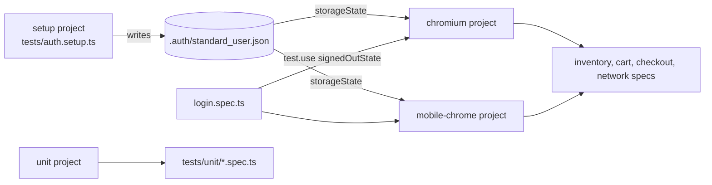

# Playwright end-to-end suite

End-to-end tests for the public Swag Labs demo shop (https://www.saucedemo.com), written in TypeScript with Playwright 1.63.

The suite covers login, the product list, the cart, the full checkout flow and a few network checks. It runs on desktop Chrome and on a Pixel 7 emulation. 68 tests run in about 40 seconds with three workers.

## Start here

If you have five minutes, read these three files:

1. `src/fixtures/test.ts`: how tests get their page objects.
2. `src/pages/inventory.page.ts` and `src/components/product-card.component.ts`: how a product is addressed by name.
3. `tests/checkout.spec.ts`: a full purchase with `test.step` blocks and a check of the order math.

## How to run

```bash
npm install
npx playwright install chromium   # once, downloads the browser
npm test                          # all projects
npm run test:smoke                # only tests tagged @smoke
npm run test:headed               # watch the browser
npm run test:ui                   # Playwright UI mode
npm run report                    # open the last HTML report
npm run typecheck && npm run lint
```

Set `BASE_URL` to point the suite at another deployment of the same app. Set `CI=1` to get retries, two workers and the GitHub reporter.

## Structure

```
playwright/
├── playwright.config.ts        projects, reporters, timeouts, testIdAttribute
├── src/
│   ├── components/             header and product card component objects
│   ├── data/users.ts           the public demo accounts
│   ├── fixtures/test.ts        test fixtures that hand page objects to tests
│   ├── pages/                  one page object per screen
│   └── utils/money.ts          price parsing in cents
└── tests/
    ├── auth.setup.ts           signs in once and saves the browser state
    ├── login.spec.ts           login rules, data-driven accounts, aria snapshot
    ├── inventory.spec.ts       sorting, cart badge, product details, logout
    ├── cart.spec.ts            cart contents, remove, reload
    ├── checkout.spec.ts        full purchase and form validation
    ├── network.spec.ts         route blocking, asset health, API request
    └── unit/money.spec.ts      helper tests, no browser
```

## Projects and sign-in



The `setup` project signs in through the real form once and saves cookies and local storage. The browser projects depend on it, so every test starts signed in and the suite pays for one login. `login.spec.ts` overrides `storageState` with an empty state because it tests the login form itself.

The `unit` project runs the money helpers without a browser.

## Locator strategy

The site exposes `data-test` attributes, so `testIdAttribute` is set to `data-test` in the config and `getByTestId` works without extra selectors. Locators follow this order:

| Priority | Locator | Example in this suite |
|---|---|---|
| 1 | `getByRole` with an accessible name | `getByRole('button', { name: 'Add to cart' })` |
| 2 | `getByLabel`, `getByPlaceholder` | the checkout form fields |
| 3 | `getByText` with `exact: true` | product names when filtering a card |
| 4 | `getByTestId` | `inventory-item`, `shopping-cart-badge`, `error` |
| 5 | CSS by structure | not used; styling classes change too often |
| never | XPath, nth-child chains | |

Rules the code follows:

- A product is found by name, not by index: `inventoryPage.product('Sauce Labs Backpack')`. The card is `items.filter({ has: getByText(name, { exact: true }) })`.
- Assertions are web-first (`toHaveText`, `toHaveCount`, `toBeVisible`) so they wait and retry. Lists are checked with `toHaveText([...])`, which waits for the whole list to match in order.
- Checks that need computed data use `expect(async () => {...}).toPass()` instead of reading the DOM once.
- No `waitForTimeout`. Navigation waits on the URL or on a visible element of the next page.
- Accessible names are part of the contract: the cart link is asserted with `toHaveAccessibleName('Cart, 1 items')`, and the login form has an aria snapshot.

One real lesson is written down in `src/pages/product-details.page.ts`. The details page reuses the `inventory-item` test id of the product list, and both can be in the DOM for a moment while the app swaps routes. Scoping the details locators to the container that holds the plain `add-to-cart` button removed a flaky failure on the mobile project.

## Why page objects plus fixtures

Page objects hold the locators and the small actions of one screen. Fixtures build those objects for each test, so a test asks for `inventoryPage` and `cartPage` by name and never calls `new`. This keeps three things apart:

- Locators live in one place per screen (`src/pages`, `src/components`).
- Setup lives in fixtures (`src/fixtures/test.ts`, `tests/auth.setup.ts`).
- Tests read like the user story they check.

Component objects (`HeaderComponent`, `ProductCardComponent`) cover parts of the UI that appear on several screens, so the cart badge or a product row is defined once.

## Tags

Tests carry `@smoke` or `@regression`. `npm run test:smoke` runs the 13 smoke tests in about 20 seconds. Use `--grep @regression` for the rest.

## Reports and debugging

- HTML report in `playwright-report/` (`npm run report`).
- JUnit XML in `results/junit.xml` for CI dashboards.
- On failure: screenshot, video and, on retry, a trace. Open a trace with `npx playwright show-trace <file.zip>`.

## CI

The root workflow installs Node 22, runs `npm ci`, installs Chromium with `npx playwright install --with-deps chromium`, runs `npm test` with `CI=1` and uploads `playwright-report/` and `results/` as artifacts.

## Adding browsers

Install the engines once with `npx playwright install firefox webkit`, then add projects to `playwright.config.ts`:

```ts
{ name: 'firefox', use: { ...devices['Desktop Firefox'], storageState: STORAGE_STATE }, dependencies: ['setup'] },
{ name: 'webkit', use: { ...devices['Desktop Safari'], storageState: STORAGE_STATE }, dependencies: ['setup'] },
```

## Test accounts

The accounts in `src/data/users.ts` are printed on the demo site's login page. They are public demo credentials, not secrets.
